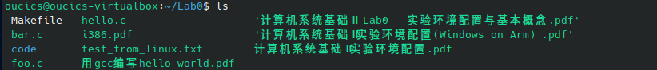
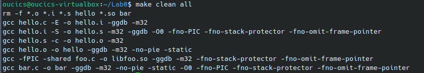
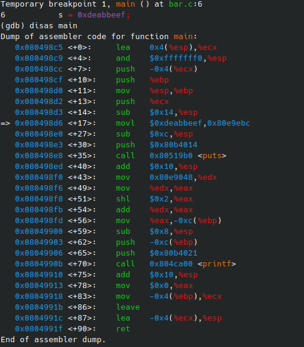
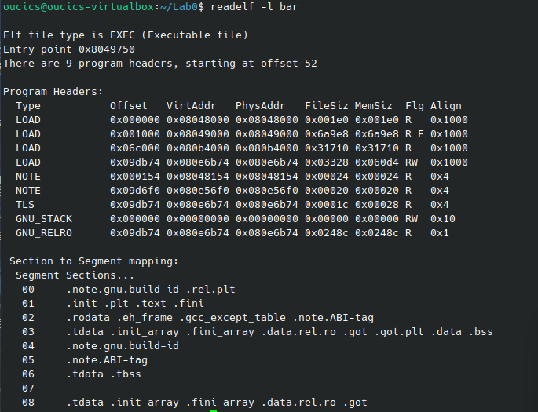
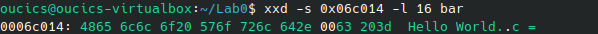

\tableofcontents
\newpage

# 一、 实验环境配置

先把虚拟机环境跑通。在 VirtualBox 设置好共享文件夹后，在终端挂载，然后把源码拷到本地目录。

```bash
cp /mnt/icslab/* .
make clean all
```

把文件都准备妥当并编译通过：



<p align="center"><i>图 1：实验文件就绪</i></p>



<p align="center"><i>图 2：make clean all 编译成功</i></p>

\newpage

# 二、 任务 2.1：可重定位目标文件 vs 可执行文件

**1. 实验过程**

用 `objdump` 把中间产物 `hello.o` 和最终的 `hello` 都反汇编出来，然后用 `diff` 提取差异。

```bash
objdump -S -M intel,i386 hello > hello-1.txt
objdump -S -M intel,i386 hello.o > hello-2.txt
diff hello-1.txt hello-2.txt | head -n 40
```

截取了终端里输出的一部分差异（左边是最终文件，右边是 .o 文件）：

```text
< Disassembly of section .init:
< 08049000 <_init>:
<  8049000:	53                   	push   ebx
...
---
> Disassembly of section .text:
> 00000000 <test>:
>    0:	55                   	push   ebp
>    1:	89 e5                	mov    ebp,esp
```

**2. 分析**

仔细看反汇编结果，差别非常明显。在 `hello.o` 里，只要遇到调用 `printf`、`malloc` 这种外部函数，`call` 后面的地址全是 `0`。但在最终的 `hello` 里，地址全变成了真实的十六进制数字（比如 `0x804xxxx`）。

\begin{mybluebox}
\textbf{我的理解：}
编译器在编译单个 C 文件时，根本不知道外部函数最后会被放到内存的哪个位置。所以它只能先在 `.o` 文件里填个 `0` 占位。等链接器把所有的 `.o` 打包在一起时，才会计算出真实的地址并填进去（重定位）。

另外，`.o` 文件的代码段是从 `0x0` 开始算偏移的，而最终由于加了 `-no-pie` 参数，可执行文件被死死固定在了 `0x08049000` 这种高虚拟地址上。
\end{mybluebox}

\newpage

# 三、 任务 2.2：调试分析

**1. 找字符串的内存地址**

我们要在 `bar` 里找 `"Hello World."`。进 GDB 跑 `disas main`，看到调用 `call puts` 打印字符串之前，有一句 `push 0x80b4014`。所以这个字符串在内存里的首地址就是 `0x80b4014`。



<p align="center"><i>图 3：GDB 反汇编查找字符串地址</i></p>

**2. 查程序头表找偏移**

知道内存地址后，还得算它在硬盘文件里的物理偏移。用 `readelf -l bar` 查看，找到包含 `0x80b4014` 的那个 `LOAD` 段：

```text
Type   Offset   VirtAddr   PhysAddr   FileSiz  MemSiz   Flg Align
LOAD   0x06c000 0x080b4000 0x080b4000 0x31710  0x31710  R   0x1000
```

\begin{mybluebox}
\textbf{提取出的关键数据：}
\begin{itemize}
    \item 文件偏移（Offset） = \texttt{0x06c000}
    \item 虚拟地址（VirtAddr） = \texttt{0x080b4000}
\end{itemize}
\end{mybluebox}



<p align="center"><i>图 4：readelf 查看程序头表</i></p>

**3. 计算与验证**

套用公式：`文件偏移 = 段Offset + (字符串地址 - 段VirtAddr)`
代入算一下：`0x06c000 + (0x80b4014 - 0x080b4000) = 0x06c014`。

用 `xxd` 去文件里看这个位置是不是字符串：

```bash
xxd -s 0x06c014 -l 16 bar
```

```text
0006c014: 4865 6c6c 6f20 576f 726c 642e 0063 203d  Hello World..c =
```

输出 `Hello World.`。



<p align="center"><i>图 5：xxd 成功验证字符串位置</i></p>

\newpage

# 四、 问题与解答

\begin{mybluebox}
\textbf{Q1. 尝试用自己的话简单解释 Program Counter 是什么？}

\textbf{答：}在 x86 里就是 EIP 寄存器。把它当成一个指路牌，它永远指着 CPU 下一条要执行的指令。CPU 每次拿完指令，这个指路牌就自动往后挪一点，程序就这么按顺序跑起来了。
\end{mybluebox}

\begin{mybluebox}
\textbf{Q2. 说说段在进程加载中所起到的作用。}

\textbf{答：}段就是操作系统往内存里“搬运”文件的图纸。它不仅告诉系统怎么搬，还负责管权限。比如代码段（`.text`）被搬进去后只有“读”和“执行”的权限，防止程序乱改自己；而数据段（`.data`）有“读写”权限，用来存变量。
\end{mybluebox}

\begin{mybluebox}
\textbf{Q3. 二进制中的 4865 6c6c ... 是怎么对应到 Hello World 的？}

\textbf{答：}其实底层存的全是 0 和 1。`xxd` 工具把 8 个比特拼成一个字节，用十六进制显示给我们看。字符 `H` 的 ASCII 码是 72，换成十六进制就是 `48`。字母 `e` 是 `65`。一串字母排在一起，就成了 `48 65 6c 6c ...`，最后的 `00` 是 C 语言约定的字符串结束符。
\end{mybluebox}

# 五、 实验总结

做这个实验之前，平时写 C 语言没思考过程序到底是怎么跑起来的。这次自己用 `objdump` 和 `readelf`，才算是真正搞懂了可重定位文件和可执行文件的区别。
最后用 `xxd` 在二进制文件里把 `Hello World` 输出的时候，让我理清了虚拟地址、文件偏移和程序头表之间的映射关系。
